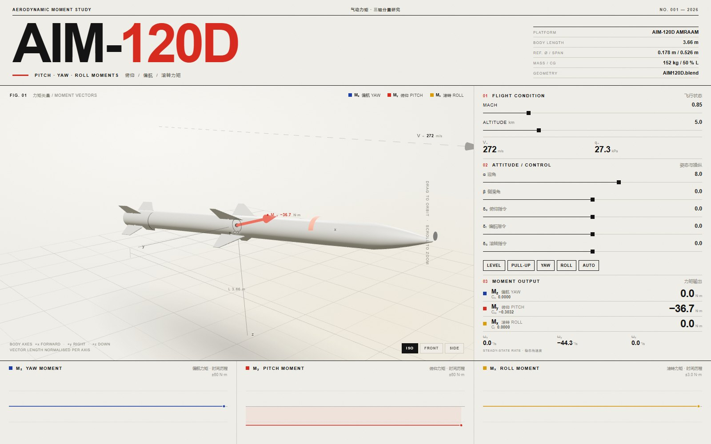
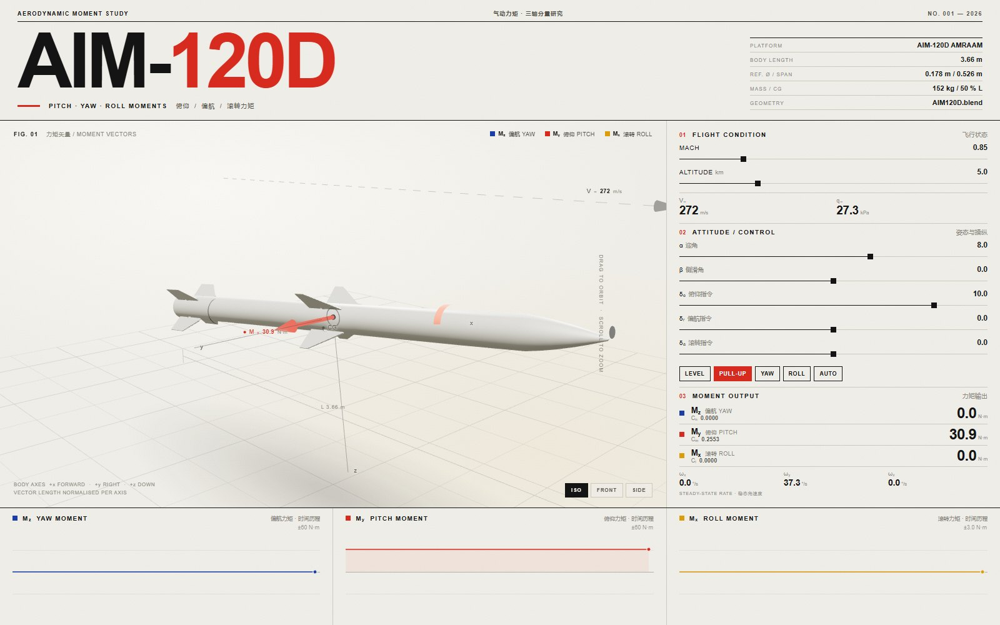

# AIM-120D — 三轴力矩研究 / Moment Study

以用户提供的 `AIM120D.blend` 弹体为几何来源，交互展示**俯仰力矩 My**、**偏航力矩 Mz**、
**滚转力矩 Mx** 的矢量方向、力矩系数与时间历程。纯静态页面，无构建步骤。

**Live:** https://kuada1.github.io/aim120d-moments/




## 特性

- **真实几何**：`AIM120D.blend` → OBJ → 三角化 / 40° 折痕角法线 / 质心归零 → `js/missile.mesh.js`，
  弹体长 3.66 m，X 形尾翼布局。
- **力矩矢量**：三轴力矩从质心起绘，颜色与数值联动；滚动轴实时响应，俯仰/偏航轴按准静态给出。
- **实时图表**：Mx / My / Mz 三条时间历程，自动对称量程，DPR 2 抗锯齿。
- **交互**：马赫数、高度、迎角 α、侧滑角 β、三个控制指令 δe/δr/δa；LEVEL / PULL-UP / YAW / ROLL / AUTO 预设；
  拖拽环绕、滚轮缩放、ISO/FRONT/SIDE 视角。
- **瑞士国际主义**：纸色 + 墨黑 + 单一红，严格网格、细线、Helvetica 系字体、表格化数字。

## 本地运行

```bash
python -m http.server 4180        # 打开 http://127.0.0.1:4180
```

直接从 `file://` 打开 `index.html` 亦可（全部为经典 script，无 fetch / 无 CDN）。

## 测试

```bash
node tests/aero.test.mjs         # 12 项气动模型断言
```

## 文件结构

```
index.html              页面结构与文案
css/style.css           设计系统（纸色 / 网格 / 字体 / 响应式）
js/three.min.js         Three.js r137 (UMD)
js/missile.mesh.js      由 AIM120D.obj 预处理的网格与法线
js/aero.js              气动导数模型（UMD，可在 Node 中测试）
js/charts.js            MomentChart 时间历程图
js/scene.js             三维场景、力矩矢量、标签
js/app.js               状态、交互、动画循环
assets/AIM120D.obj      原始网格
assets/mesh-meta.json   网格统计
tools/                  网格构建、截图、诊断脚本
tests/                  气动模型测试
```

## 模型说明

- 坐标：O-xyz 右手系，+x 弹头、+y 右翼、+z 下方；按右手定则 Mx 滚转、My 俯仰、Mz 偏航。
- 力矩按**零角速度准静态**计算：`M = q∞ · S · Lref · C`，参考面积 S = πd²/4，
  俯仰/偏航参考长度取 d = 0.178 m，滚转取 b = 0.526 m。
- 三个轴同时给出由阻尼导数平衡得到的**稳态角速度** `ω = -C₀·2V / (Cq·Lref)`；
  滚转轴按该角速度实时旋转（滚转不改变 α/β），俯仰/偏航为受控保持。
- 气动系数为公开资料量级的**教学估算**，不是 CFD 或风洞数据；几何来自 .blend，未二次造型。

## 许可 / 来源

弹体模型：爱给网免费模型 `AIM120D.blend`（Blender 2.70），仅用于本演示。
代码：MIT。
